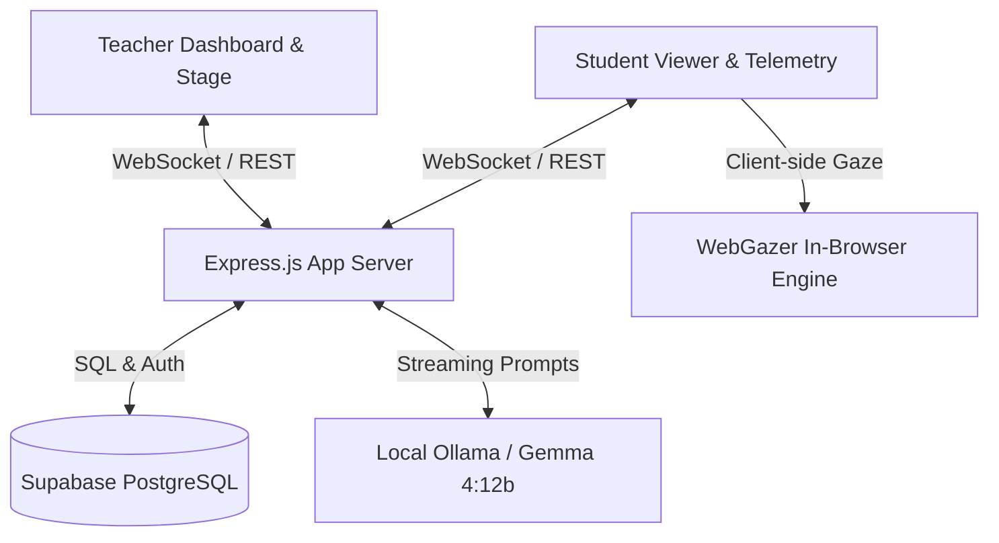

# Mentora (FocusAI Platform)

> **Real-Time Multimodal AI Learning Intelligence Platform**  
> Empowering educators with live cognitive telemetry, grounded AI pedagogical assistance, and actionable comprehension analytics.

[](LICENSE)
[](https://nodejs.org/)
[](https://supabase.com/)
[](https://ollama.ai/)

---

## 📌 Overview

**Mentora** is an intelligent classroom operating system designed to detect and resolve student learning obstacles during live instruction—before students fall behind.

Traditional classroom technology is reactive, relying on delayed homework or post-lecture quizzes. Mentora continuously synthesizes multimodal classroom signals in real time to answer four critical pedagogical questions:

1. **What concept is being taught right now?**
2. **Which concepts, paragraphs, or slides are causing confusion?**
3. **Is the difficulty localized to an individual or widespread across the class?**
4. **How should the teacher re-explain, clarify, or pace the material?**

---

## ✨ Key Capabilities

### 1. 📡 Multimodal Classroom Telemetry
- **Live Slide Synchronization**: Real-time instructor-student presentation mirroring powered by WebSockets.
- **Consent-First Gaze Estimation**: Optional, privacy-preserving client-side gaze tracking (WebGazer.js) to detect paragraph dwell times, regressions, and disengagement without video recording or streaming.
- **Instant Student Feedback**: Direct one-click confusion signals (`Confused`, `Lost`, `Too Fast`, `Clear`).
- **Interactive Comprehension Quizzes**: Spontaneous micro-quizzes launched directly from slide content with real-time confidence ratings.

### 2. 🧠 Local AI Copilot (Ollama + Gemma)
- **Concept Extraction**: Automatically parses slide decks into key concept nodes and difficulty flags.
- **Grounded Summaries**: Synthesizes actual slide text into concise teaching reminders.
- **Pedagogical Interventions**: Generates alternative explanations, real-world analogies, and step-by-step scaffolds tailored to detected points of confusion.

### 3. 📊 Phase 5 Learning Analytics & Post-Reiteration Tracking
- **Multi-Denominator Accounting**: Maintains statistical integrity by separating:
  - *Expected Class Size* (Roster)
  - *Connected Students* (Active WebSocket room)
  - *Feedback Respondents* (Active feedback voters)
  - *Test Respondents* (Quiz participants)
  - *Gaze Participants* (Calibrated eye-tracking users)
- **Post-Reiteration Resolution Engine**: Evaluates comprehension accuracy before vs. after teacher intervention (`resolved`, `partially_resolved`, `needs_further_review`).
- **Individual Student Learning Profiles**: Direct observation logs (quiz errors, feedback votes) distinct from inferred attention signals.
- **Strict Privacy Isolation**: Enforces tenant-level and role-based privacy (`403 Forbidden` on unauthorized cross-student data access).
- **Multi-Session History**: Longitudinal class performance tracking across academic terms.

---

## 🏗️ Architecture & Tech Stack



- **Frontend**: Responsive Vanilla ES6 JavaScript, HTML5 Semantic Layouts, Glassmorphism CSS Design System.
- **Backend**: Node.js, Express.js, WebSockets (`ws`).
- **Database & Auth**: Supabase PostgreSQL with Row Level Security (RLS) & JWT authentication.
- **AI Engine**: Ollama proxy integrating local Gemma 4:12b / DeepSeek models.
- **Testing**: Vitest & Node integration suites.

---

## 🚀 Quick Start Guide

### Prerequisites
- [Node.js](https://nodejs.org/) (v18.0.0 or higher)
- [Supabase](https://supabase.com/) project (with schema migrations applied)
- *(Optional)* [Ollama](https://ollama.ai/) running locally for AI features (`ollama run gemma:latest`)

### 1. Installation
```bash
npm install
```

### 2. Environment Configuration
Create a `.env` file based on `.env.example`:
```env
PORT=3000
SUPABASE_URL=https://<your-project-ref>.supabase.co
SUPABASE_ANON_KEY=<your-publishable-key>
SUPABASE_SERVICE_ROLE_KEY=<your-secret-key>
SESSION_SECRET=your_secure_session_secret
OLLAMA_BASE_URL=http://localhost:11434
```

### 3. Run the Development Server
```bash
npm start
```
Open your browser at `http://localhost:3000`.

---

## 🧪 Testing

```bash
# Vitest unit & API tests
npm test

# Comprehensive Phase 5 Analytics integration test
node scratch/test_phase5.js
```

---

## 🔒 Privacy & Ethical AI Standards

- **No Video Recording**: Gaze coordinates are calculated client-side in Web Workers; raw video frames never leave the student's browser.
- **Explicit Consent**: Gaze tracking requires opt-in calibration; students can revoke consent anytime.
- **Separation of Evidence**: Algorithmic inferences are strictly labeled as inferred observations and never mixed with factual assessment submissions.
- **Role-Based Access Control**: Student profiles are only visible to the instructor and the individual student.

---

## 📄 License

This project is licensed under the [MIT License](LICENSE) — see the LICENSE file for details.

Copyright (c) 2026 **Ayush Arun**.
